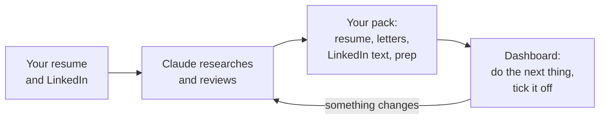

<sub>Contributing? Run `git config core.hooksPath .githooks` once after cloning, then read [CONTRIBUTING.md](CONTRIBUTING.md).</sub>

# resume-pipeline

**Your job search, run like a project.** Give Claude your resume and your LinkedIn profile. About
twenty minutes later you have everything you need to apply, and a dashboard that tells you what to do
next.

It works for your own search, or for a whole team: keep one pack per person, all in one folder.

## What you get

| | |
|---|---|
| **A resume that gets through the filters** | One page, built to survive the automatic screening (ATS) that most companies run before a person reads anything. PDF to upload, Word for portals that want it. |
| **Resumes for each kind of role** | Applying to frontend *and* backend jobs? You get a resume for each role your experience genuinely supports. Same facts, different emphasis. |
| **A resume tailored to one job** | Paste a job ad and get a version reordered for it in seconds, plus an honest list of what the ad asks for that you can't claim. |
| **LinkedIn fixes, ready to paste** | A new headline, an About section and experience text, each with the steps to apply it, checked against your resume so the two never disagree. |
| **Five reviewers, before the real ones** | A recruiter, a hiring manager, a technical interviewer, an HR/background checker and a domain lead each judge your materials separately, and say what would stop them. |
| **Live job research** | Real current listings for your target roles and cities, and the keywords those ads keep asking for. |
| **Cover letters** | A main letter and a short version for emails and LinkedIn messages, plus a tailored letter for any job on request. |
| **Interview preparation** | A six-week plan, a bank of stories to tell, and a ready-made prompt that turns ChatGPT into a mock interviewer. |
| **A dashboard to work from** | Every improvement as a card you can tick off, your scores, your documents, and a weekly tracker that tells you where applications are getting stuck. |

**Nothing is made up.** Every line on your resume traces back to your own documents. Where something is
missing, Claude either asks you or marks its best guess so you can confirm it. When your resume or
LinkedIn changes later, it updates only what's affected and keeps everything you've already confirmed.

## How it works



## Get started

You'll do this once. It takes about ten minutes, plus about twenty for your first pack.

### Step 1. Get Claude Code

Claude Code is the version of Claude that can work with files on your computer. It needs a paid Claude
plan (Pro, Max, Team or Enterprise) or an Anthropic Console account.

Install it from **[claude.com/claude-code](https://claude.com/claude-code)** and sign in.

### Step 2. Add this plugin

Open the **Terminal** app:

- **Mac:** press <kbd>Cmd</kbd> + <kbd>Space</kbd>, type `Terminal`, press <kbd>Enter</kbd>.
- **Windows:** open **PowerShell** from the Start menu.
- **Linux:** open your terminal.

Paste these two lines, one at a time, pressing <kbd>Enter</kbd> after each:

```bash
claude plugin marketplace add mrinal-aswin/resume-pipeline
```

```bash
claude plugin install resume-pipeline@resume-pipeline
```

Each line ends with a green tick and "Successfully added" or "Successfully installed".

### Step 3. Make a folder for your job search

Your packs live in an ordinary folder. Still in Terminal, paste these three lines:

```bash
mkdir -p ~/job-search
```

```bash
cd ~/job-search
```

```bash
claude
```

On Windows PowerShell, use `mkdir $HOME\job-search` and `cd $HOME\job-search` for the first two lines.

Claude Code starts inside that folder. Next time, just open Terminal and run the last two lines again.

### Step 4. Let Claude check your computer

Type this to Claude, in plain words:

> Check the resume-pipeline setup and help me install anything that's missing.

It checks for four free tools (listed under [What it needs](#what-it-needs)) and walks you through
installing any that are missing. When everything is there, it says **Ready**.

### Step 5. Build your first pack

Type:

> Build my job-search pack.

Then **attach your resume** to the chat: drag the file in, or use the paperclip. PDF, Word or text all
work.

Claude asks a few questions, one at a time, usually with buttons to click:

1. **Whose profile is this?** Yours, or someone else's. For someone else's, Claude checks they know and
   agree, because the pack holds their career history.
2. **Your resume,** if you haven't attached it yet.
3. **Your LinkedIn profile:** confirm the link, then choose how Claude reads it (see [LinkedIn](#linkedin)).
4. **The jobs you want:** the titles, cities, and whether you're open to remote work. Claude suggests
   these from your resume; just confirm or change them.
5. **Missing details:** have Claude fill gaps with clearly marked best guesses (recommended), or leave
   visible blanks.

Say **"go"** at any point and Claude carries on with what it has.

Then it gets to work. Research and the five reviewers run at the same time, so the first pack takes about
**10 to 20 minutes**. Later updates are much quicker.

### Step 6. Open your dashboard

Type:

> Start my dashboard.

Claude starts it and gives you a link, usually **http://localhost:8765**. Open it in your browser. It runs
only on your computer.

Start with **Do next** on the Overview tab, and work down the list.

## Your dashboard

| Tab | What it's for |
|---|---|
| **Overview** | Where you stand at each stage of hiring, from "can recruiters find me?" to "will I pass the background check?" Plus your **Do next** list and key numbers. |
| **Actions** | Every improvement as a card: why it matters, a link to the exact page, text to copy, and step-by-step help. Mark each one **Resolved** or **Ignored** when you're done. Undo is there if you misclick. |
| **Documents** | Download your resume, cover letters, learning plan and mock-interview prompt as PDF, Word or text. |
| **Tailor to a job** | Paste a job ad and get a resume tailored to it in seconds. |
| **Lenses** | What each of the five reviewers thought, and the problems two or more of them agreed on. |
| **ATS** | How well your resume and LinkedIn match the keywords employers search for, and one-click copying of skills to add to LinkedIn. |
| **Funnel** | Each week, log how many applications, replies and interviews you got. It tells you which stage is leaking. |
| **Framework** | The hiring stages explained, and what to do when one is the problem. |

Everything you tick is saved straight away. If you open the dashboard file directly instead of through
Claude, it remembers your clicks in that browser and gives you a button to save them properly later.

## What to say to Claude

Plain words work. Some examples:

| You want to... | Say |
|---|---|
| Update your resume | "I have a new resume." *(attach it)* |
| Refresh after editing LinkedIn | "My LinkedIn changed." |
| Apply for a specific job | "Tailor my resume to this job:" *(paste the ad)* |
| Get a cover letter for it | "Write a cover letter for this job." |
| Apply to more than one kind of role | "Which roles does my profile support? Make a resume for each." |
| Answer Claude's open questions | "Here are my answers: I started at my current job in March 2021..." |
| Log a week of applications | "This week: 8 applications, 2 replies, 1 interview." |
| Get a straight opinion | "Review my resume like a recruiter would." |
| Prepare for interviews | "Help me prepare for interviews." |
| Help a colleague | "My teammate Priya wants to prepare for senior backend roles in Bengaluru." |

When something in a pack is out of date, Claude mentions it at the start of your next session and offers
to update it.

## LinkedIn

Claude reads your profile in one of two ways. You choose when it asks.

- **Through Chrome (recommended).** Install the **Claude in Chrome** extension and sign in to LinkedIn
  yourself. Claude reads the profile through your own browser. It never asks for your password and never
  clicks anything on your profile.
- **From a PDF.** On your LinkedIn profile, click **More**, then **Save to PDF**, and attach the file to the
  chat.

## Where your files are

Everything stays in the folder you made in Step 3:

```text
job-search/
└── people/
    └── your-name/
        ├── inputs/          every resume and LinkedIn copy you've given, dated, never changed
        ├── outputs/
        │   ├── actions.html     your dashboard
        │   ├── resume/          your resume (PDF, Word) and the list of details to confirm
        │   ├── cover-letters/
        │   └── ...              reviews, research, learning plan, mock-interview prompt
        └── CHANGELOG.md     what changed each time Claude updated the pack
```

## Privacy

A pack holds personal information: contact details, work history, and the decisions you made.

- Everything stays on your computer. The dashboard runs only on your machine.
- Build a pack for someone else only with their agreement.
- Don't upload the `people/` folder anywhere public. If you keep your job-search folder in git, add
  `people/` and `raw/` to its `.gitignore`.
- This plugin contains no personal data, and its automatic checks refuse any that's added by mistake.

## What it needs

Four free tools. Claude checks for them in [Step 4](#step-4-let-claude-check-your-computer) and helps you
install any that are missing.

| Tool | What it does | Mac | Windows / Linux |
|---|---|---|---|
| Python 3.10 or newer | runs the pipeline | usually already there | [python.org](https://www.python.org/downloads/) |
| pandoc | makes the Word documents | `brew install pandoc` | [pandoc.org](https://pandoc.org/installing.html) |
| poppler | reads PDFs the way screening software does | `brew install poppler` | `apt install poppler-utils` |
| Chrome, Chromium or Edge | turns documents into PDFs | [google.com/chrome](https://www.google.com/chrome/) | usually already there |

The Mac commands use [Homebrew](https://brew.sh). It's tested on macOS; Linux should work; Windows is
untested.

## If something goes wrong

<details>
<summary><b>Claude says it can't read my file ("Operation not permitted")</b></summary>

On a Mac, apps need permission to read your Downloads, Desktop and Documents folders. Claude gives you a
one-line command to copy the file somewhere it can read. Paste that command into Terminal, press
<kbd>Enter</kbd>, and tell Claude it's done.
</details>

<details>
<summary><b>Claude can't read my LinkedIn</b></summary>

Check that the Claude in Chrome extension is installed and that its side panel is open in Chrome, signed
in to the same Claude account. If it still can't connect, use **More → Save to PDF** on your profile and
attach the file instead.
</details>

<details>
<summary><b>Claude doesn't seem to know about the plugin</b></summary>

Close Claude Code and open it again; plugins load when it starts. To check that it's installed, run
`claude plugin list` in Terminal and look for `resume-pipeline`.
</details>

<details>
<summary><b>My clicks on the dashboard aren't saved</b></summary>

Open the dashboard through Claude ("Start my dashboard") rather than by double-clicking the file. If you
already made changes in the file version, they're kept in that browser: start the dashboard and use
**Save to database** on the bar at the bottom.
</details>

<details>
<summary><b>The dashboard link doesn't open</b></summary>

The dashboard runs only while Claude Code has it started. Ask Claude to "start my dashboard" again and use
the link it gives you.
</details>

<details>
<summary><b>My resume runs over one page</b></summary>

Ask Claude to "tighten the resume to one page". It shortens bullets rather than shrinking the text. With
twelve or more years of experience, two pages is normal; tell Claude if you'd prefer that.
</details>

<details>
<summary><b>How much does it cost?</b></summary>

The plugin is free. It uses your normal Claude Code allowance. A first pack is the biggest job, because
of the research and the five reviewers; updates use much less.
</details>

## Update or remove

To get the latest version, run this in Terminal:

```bash
claude plugin update resume-pipeline@resume-pipeline
```

To remove it:

```bash
claude plugin uninstall resume-pipeline@resume-pipeline
```

Removing the plugin doesn't touch your packs. Your `people/` folder stays exactly as it was. What's new
in each version is in the [changelog](CHANGELOG.md).

## Other ways to use it

- **Without the plugin system:** copy `skills/resume-pipeline/` into a project's `.claude/skills/` folder.
  To get the start-of-session reminder, also merge `skills/resume-pipeline/assets/session-start-hook.json`
  into that project's `.claude/settings.json`.
- **On claude.ai or in the Claude desktop app (experimental):** run `tools/build-skill-zip.sh` and upload
  `dist/resume-pipeline.zip` under Settings → Capabilities → Skills. Reviews and writing work there.
  Making PDFs needs the tools above, which only Claude Code on your own computer has.
- **Try a copy without installing it:** `claude --plugin-dir /path/to/resume-pipeline`.

## License

MIT. See [LICENSE](LICENSE).
